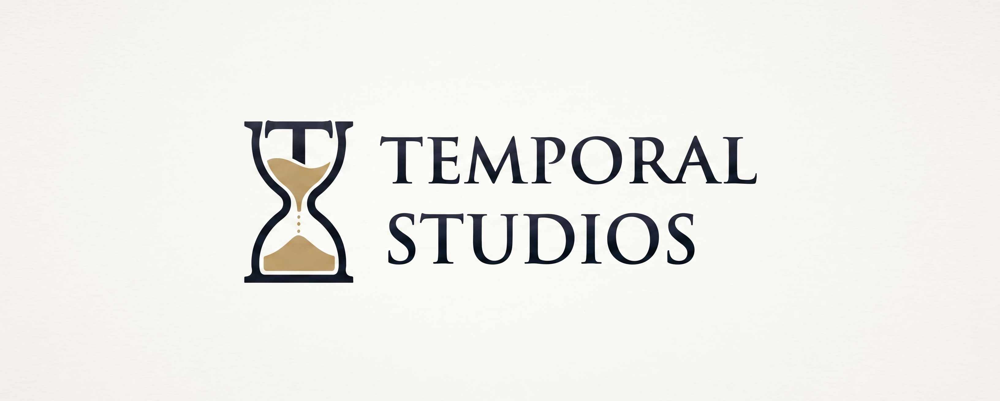

  

  <i>"Time Moves Forward. Legends Remain."</i>

  Creating immersive worlds, challenging adventures, and unforgettable gaming experiences.

---

### 🌑 About Temporal Studio

Welcome to **Temporal Studio**.

We are an independent game development studio focused on creating original gaming experiences, with a passion for RPGs, Dark Fantasy worlds, strategic combat, and immersive storytelling.

Powered by **Godot Engine**, we transform creative ideas into interactive worlds, building unique gameplay systems and memorable adventures.

### ⚔️ What We Create

- Dark Fantasy RPGs
- Android Games
- Turn-Based & Tactical Combat
- Character Progression Systems
- Skills, Abilities & Equipment
- World Building & Exploration
- Crafting & Game Mechanics

### 🛠️ Development Technologies

  

- **Engine:** Godot Engine
- **Programming:** GDScript
- **Platform:** Android
- **Version Control:** Git & GitHub

### 📜 Current Development

Currently working on original game projects, focusing on gameplay architecture, user interface, combat mechanics, character systems, and world exploration.

Every project is an opportunity to create something new.

### 🏰 Our Philosophy

- **Creativity** — Bring new ideas to life.
- **Exploration** — Discover endless possibilities.
- **Persistence** — Keep building, keep improving.
- **Challenge** — Create experiences worth overcoming.

---

  <b>TEMPORAL STUDIO</b>
   
  TIME MOVES FORWARD. LEGENDS REMAIN.
    
  Independent Game Development · Est. 2026

